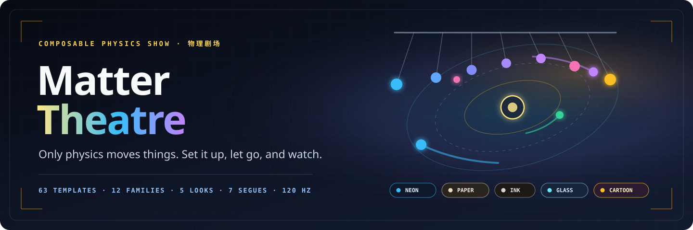
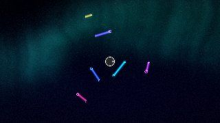
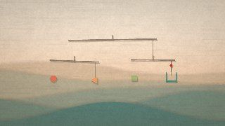
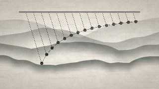
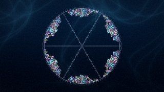
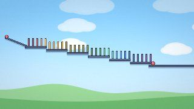
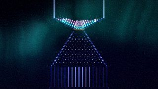

<p align="center">
  <a href="https://seiya058904.github.io/matter-theatre/">
    
  </a>
</p>

<h1 align="center">🎭 Matter Theatre</h1>

<p align="center"><sub>物理剧场</sub></p>

<p align="center">
  <strong>Only physics moves things. Set it up, let go, and watch.</strong>
</p>

<p align="center">
  A composable physics show built on <a href="https://brm.io/matter-js/">Matter.js</a> and <a href="https://pixijs.com/">PixiJS</a>.<br>
  Open the page and a hand-picked running order of short physics pieces plays in a seamless loop —<br>
  or open <strong>Compose</strong> to direct your own show from 63 templates, five looks, and seven segues, then export it as video.
</p>

<p align="center">
  <a href="https://seiya058904.github.io/matter-theatre/"></a>
  
  
  
  
</p>

<p align="center">
  <a href="https://seiya058904.github.io/matter-theatre/"><strong>▶ Watch the Show</strong></a>
  &nbsp;·&nbsp;
  <a href="#five-looks">🎨 Five Looks</a>
  &nbsp;·&nbsp;
  <a href="#how-it-works">⚙️ Principles &amp; Segues</a>
  &nbsp;·&nbsp;
  <a href="#templates">🎬 63 Templates</a>
  &nbsp;·&nbsp;
  <a href="#controls">⌨️ Controls</a>
  &nbsp;·&nbsp;
  <a href="#architecture">🛠️ Architecture</a>
</p>

<p align="center">
  <sub>63 TEMPLATES &nbsp;·&nbsp; 12 FAMILIES &nbsp;·&nbsp; 5 COMPLETE LOOKS &nbsp;·&nbsp; 7 SEGUES &nbsp;·&nbsp; 120 HZ FIXED PHYSICS &nbsp;·&nbsp; MP4 / WEBM EXPORT</sub>
</p>

---

> **No title card. No ending. No text inside the picture.**
>
> Gravity, contacts, friction, restitution, constraints, real force laws (Hooke, ideal gas, Archimedes, Newton, Coulomb) drive every single frame. A template may only arrange initial conditions and *let go* — release a ball, open a gate, cut a string, start a visible motor, or tilt a container. Nothing is nudged, clamped, or teleported afterwards.

<a id="five-looks"></a>
## 🎨 Five Complete Looks

**Templates never pick colours.** Each body declares only a *role* (`hero`, `accent`, `structure`, `ground`) and a position along the look's palette ramp — so every one of the 63 physics templates renders natively in all five visual worlds, complete with custom materials, impacts, particles, trails, two procedural backdrops, and a finishing grade.

<table>
  <tr>
    <td width="33%" valign="top">
      <a href="https://seiya058904.github.io/matter-theatre/?only=kepler&amp;style=neon">
        
      </a>
      <h4>🌌 Neon</h4>
      <p><sub>GLOWING OUTLINES · AURORA / GRID</sub></p>
      <p>Luminous silhouettes, crisp motion trails, and aurora or horizon-grid backdrops.</p>
    </td>
    <td width="33%" valign="top">
      <a href="https://seiya058904.github.io/matter-theatre/?only=calder-mobile&amp;style=paper">
        
      </a>
      <h4>📄 Paper</h4>
      <p><sub>LAYERED CUT PAPER · SOFT SHADOWS</sub></p>
      <p>Warm tactile craft paper stock with gentle elevation shadows and muted pigments.</p>
    </td>
    <td width="33%" valign="top">
      <a href="https://seiya058904.github.io/matter-theatre/?only=pendulum-wave&amp;style=ink">
        
      </a>
      <h4>🖌️ Ink</h4>
      <p><sub>BRUSH STROKES · RICE PAPER</sub></p>
      <p>Sumi-e washes, calligraphic trails, and misty monochrome mountain horizons.</p>
    </td>
  </tr>
  <tr>
    <td width="33%" valign="top">
      <a href="https://seiya058904.github.io/matter-theatre/?only=kaleidoscope&amp;style=glass">
        
      </a>
      <h4>💎 Glass</h4>
      <p><sub>REFRACTIVE GEMS · CAUSTIC DEPTH</sub></p>
      <p>Translucent jewel-like bodies catching specular highlights over dark water caustics.</p>
    </td>
    <td width="33%" valign="top">
      <a href="https://seiya058904.github.io/matter-theatre/?only=domino-stairs&amp;style=cartoon">
        
      </a>
      <h4>☀️ Cartoon</h4>
      <p><sub>BOLD OUTLINES · SQUASH &amp; STRETCH</sub></p>
      <p>Playful cel-shaded shapes, crisp ink outlines, bright flat colour, and lively bounce.</p>
    </td>
    <td width="33%" valign="top">
      <a href="https://seiya058904.github.io/matter-theatre/?only=galton&amp;style=neon">
        
      </a>
      <h4>✨ Any Template × Any Look</h4>
      <p><sub>315 PRE-RENDERED LIBRARY THUMBNAILS</sub></p>
      <p>Every combination works deterministically — click any card above to jump straight into that scene live.</p>
    </td>
  </tr>
</table>

<p align="center"><sub>ACTUAL PRE-RENDERED ENGINE THUMBNAILS FROM <code>public/thumbs/</code></sub></p>

<a id="how-it-works"></a>
## ⚙️ Principles, Segues & Directing

<table>
  <tr>
    <td width="50%" valign="top">
      <h3>⚖️ Pure Physical Choreography</h3>
      <p><sub>ZERO FAKE ANIMATION · SEEDED DETERMINISM</sub></p>
      <p>Each template owns an isolated Matter engine, camera, and seeded RNG running on physics time. A show unfolds identically every playback, and video exports match the live preview frame for frame.</p>
    </td>
    <td width="50%" valign="top">
      <h3>⚡ 120 Hz Fixed Step, Zero Stutter</h3>
      <p><sub>OFF-SCREEN PRE-SETTLE · RENDER INTERPOLATION</sub></p>
      <p>Physics steps at a locked 120 Hz with render interpolation. While one piece plays, the next template is built and pre-settled off-screen in tiny time slices, with shaders and shared geometry warmed up before frame one.</p>
    </td>
  </tr>
  <tr>
    <td width="50%" valign="top">
      <h3>🌊 Seven Seamless Segues</h3>
      <p><sub>GLIDE · DISSOLVE · IRIS · INK BLEED · ZOOM · DIP · FLOOR DROP</sub></p>
      <p>Join any two 9–15 second clips cleanly — including <strong>floor drop</strong>, where the outgoing floor opens and everything tumbles away. <strong>Auto</strong> picks a segue from how each clip ends (settled, periodic, or flowing) and never repeats twice in a row.</p>
    </td>
    <td width="50%" valign="top">
      <h3>🎥 Compose, Share &amp; Export Video</h3>
      <p><sub>URL-ENCODED SHOWS · 720P / 1080P MP4 OR WEBM</sub></p>
      <p>Arrange your own running order in the Compose bench, override any junction segue, share the show via its <code>#show=…</code> URL hash, or record one clean pass directly to MP4 (H.264) or WebM.</p>
    </td>
  </tr>
</table>

<a id="templates"></a>
## 🎬 63 Templates in 12 Families

| Family | Count | Templates |
| :--- | :---: | :--- |
| **Collision** | 6 | Newton's Cradle · Stacked Drop · Break Shot · Bounce Ladder · Gas Expansion · Bounce Sorter |
| **Gravity** | 6 | Brachistochrone · Projectile Fan · Tumbling Room · Trapdoor Shelves · Marble Race · Rolling Race |
| **Granular** | 8 | Galton Cascade · Hourglass · Avalanche · Marble Water-Wheel · Rotating Drum · Size Sieve · Sand Strata · Ball Pit |
| **Balance** | 4 | Balance Scale · Roly-Poly · Pyramid Demolition · Calder Mobile |
| **Oscillation** | 6 | Pendulum Wave · Double Pendulum · Harmonograph · Wrecking Ball · Spring Organ · Standing Waves |
| **Machines** | 6 | Ferris Wheel · Shishi-odoshi · Trebuchet · Overbalanced Wheel · Cam Wave · Slingshot |
| **Chain reactions** | 5 | Growing Dominoes · Domino Stairs · Seesaw Toss · Pendulum Relay · Rube Relay |
| **Fields** | 6 | Kepler's Orrery · Binary Star · Coulomb Crystal · Ionic Clusters · Accretion · Three-Body Ballet |
| **Ropes** | 4 | Rope Bridge · Chain Slide · Bead Curtain · Cut the Rope |
| **Soft bodies** | 6 | Jelly Rain · Jelly Steps · Soft Collision · Rubber Ball · Bed of Nails · Water Balloon |
| **Fluids** | 2 | Sink or Float · Overloaded |
| **Patterns** | 4 | Kaleidoscope · Stadium Billiards · Settled Mosaic · Ring Escape |

> [!NOTE]
> **Physics corrections and laws in `src/templates/kit.ts`:**
> - Matter multiplies every body's inertia by four; the kit restores true moments of inertia so balls roll and blocks tip at the right pace. `ball()` makes a 40-gon that really rolls, and static bodies keep their material.
> - Forces are laws registered once (`ctx.force`) and run before every step, including off-screen settling: Hookean springs (`spring()`), gas-filled soft bodies (`softBody()`, P·A = const, tearable skin), Archimedes buoyancy (`water()`), and pairwise mutual gravitation (`gravitate()`).
> - Containers turn, gravity does not: tumbling room, hourglass and kaleidoscope are driven by a motor (`turn()`).

<a id="controls"></a>
## ⌨️ Controls & Local Development

| Key | Action |
| :--- | :--- |
| <kbd>Space</kbd> | Play / pause |
| <kbd>←</kbd> / <kbd>→</kbd> | Previous / next template |
| <kbd>E</kbd> | Open Compose bench |
| <kbd>F</kbd> | Toggle fullscreen |
| <kbd>Esc</kbd> | Close drawer or cancel an active video recording |

```bash
npm install
npm run dev      # http://localhost:5173
npm run build    # type-check + production bundle in dist/
npm test         # unit tests (Vitest)
```

**Video export:** Recording captures the full running order once in real time to MP4 (H.264) when supported by the browser, falling back to WebM, at 720p or 1080p. Keep the browser tab in the foreground while recording.

<a id="architecture"></a>
## 🛠️ Architecture, URL Parameters & QA

<details>
<summary><strong>🔍 Expand URL preview parameters, console QA hooks &amp; module map</strong></summary>

### URL Parameters (Previews & QA)

| Parameter | Effect |
| :--- | :--- |
| `#show=…` | A shared show configuration (written automatically while you compose) |
| `?only=galton,kepler` | Play only the listed templates |
| `?all` | Play every template in library order |
| `?style=ink&bg=1&link=dissolve` | Override look, backdrop variant, and default segue |
| `?item=3&t=6&pause` | Jump directly to template 3 at 6 seconds and pause |

In the browser console, `__mt.director.qa(def)` reports setup and step timings, body counts, and escaped bodies for a template; `__mt.director.probe(def, times)` samples body positions at specific timestamps.

### Module Map

```text
src/
  core/       Stage (Pixi app, letterboxed 1920×1080 space, finish pass, quality governor),
              Director (schedule, off-screen prebuild & presettle, segues, loop, thumbnails, QA),
              Camera, Timeline, Rng
  render/     SceneRenderer (shared GraphicsContexts, interpolated views, rope trails, impacts),
              Fx (pooled particles)
  fx/         GLSL shaders: procedural backdrops, finishing grade, ink-bleed reveal
  styles/     Five StyleDefs (Neon, Paper, Ink, Glass, Cartoon)
  templates/  kit.ts (physical building blocks) and one file per family
  show/       ShowConfig, presets & shuffle, segue selection, schedule, URL serialization
  ui/         Watch chrome, compose bench, export dialog, i18n
  export/     MediaRecorder wrapper
public/
  thumbs/<look>/<template>.jpg   315 pre-rendered library thumbnails
```

### Tests

`npm test` runs the headless suites: library shape, per-template health (no NaNs, nothing lost out of shot, a calm start, something visibly happens, bit-for-bit determinism) and **outcomes** (`tests/outcomes.test.ts`: each story's payload really arrives — the shelves empty, the sieve sorts, the toss lands in its basket). `REVIEW=1 npx vitest run tests/zz-review.test.ts --reporter=verbose` prints an on-demand watchability report (wake-up time, peak, tail, framing).

### Authoring Notes (Matter.js)

- **Friction sticks on shallow slopes.** Matter warm-starts its friction impulse across steps, so at our 120 Hz step any non-zero pair friction (`min` of the two bodies) holds a body still on slopes up to ~20°, and stiction uses the *larger* `frictionStatic`. Something meant to slide off a gentle incline needs a surface with `friction: 0`; balls roll regardless.
- **Spawn clear of walls.** A soft body's skin node placed outside a wall falls through it; held bodies must not overlap each other, or a released one comes to rest on one still held.
- **Static bodies report friction 1** while held (`Body.setStatic`), and get their own value back when released.

### Thumbnails

Library thumbnails are pre-rendered into `public/thumbs/` so browsing in Compose never spins up a simulation. After adding or editing a template, regenerate them following [`docs/thumbnails.md`](docs/thumbnails.md). Missing files fall back to idle-time rendering.

</details>

## 📄 License

Private project. [Matter.js](https://brm.io/matter-js/) (MIT) and [PixiJS](https://pixijs.com/) (MIT) are used as dependencies.

---

<p align="center">
  <sub>SIXTY-THREE TEMPLATES. FIVE WORLDS. ONE ENGINE OF GRAVITY.</sub><br>
  <sub>Matter Theatre · A composable physics show for the browser.</sub>
</p>
